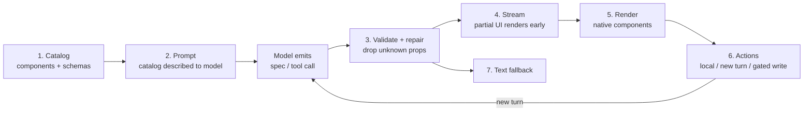

# Generative UI: what it is, how it works, and what it means for NerveCenter

Research note, 11 Oct 2026. Not a spec: nothing here is approved behaviour. Anything we build from it goes through `specs/` and `docs/adr/` first.

## TL;DR

- **Generative UI means the agent decides what the answer looks like, not only what it says.** The answer can be a ranked queue, an RCA timeline, an approval card, an email draft you can edit, or a chart you can filter. The agent picks and fills interactive components that the app renders. The industry has converged on one rule: **the model sends data, the app owns the components.** Only a few products let the model write raw HTML, and when they do it runs in a hard sandbox.
- **It went mainstream this week.** OpenAI shipped "Intelligent UI" with GPT-6 in ChatGPT on 7 Oct 2026. Claude has had inline interactive visuals since March 2026, and MCP Apps (interactive tool UIs, co-authored by Anthropic and OpenAI) has been a stable standard since January 2026.
- **NerveCenter already does the safest kind.** Sonic draws 11 kinds of card by calling `show_*` tools, which the UI renders as React components. We have the same architecture as the leaders, at its most basic level. "We only show text, static graphs and HTML" undersells it, but it does point at the real gaps:
  1. Cards are read-only. Nothing in them can be clicked to act.
  2. There is no chart in chat. Charts only exist on Boards.
  3. Cards render numbers the model typed, not numbers from the source system, so a misread value shows up looking authoritative.
  4. Every answer is laid out the same way. A stakeholder and an engineer get the same thread of cards.
  5. HTML reports are deliberately scriptless, so they are static.
- **Recommendation:** grow our own component catalog rather than adopt a framework. The changes, in order:
  1. Bind cards to real data by id.
  2. Add interactive actions through a single gated action route.
  3. Add a chart card.
  4. Add workflow components for triage, RCA, fixes, emails and documents.
  5. Later, add a composed "view" (the agent lays catalog components out on a page) and a sandboxed interactive-HTML tier.

  The off-the-shelf adapters don't fit our SDK version or our no-framework backend (see §8.4).

---

## 1. What generative UI is

A chat agent normally answers in text, or in markdown that looks like a document. With generative UI, the agent's answer is an interface: components chosen for this question, filled with this data, that the person can act on in place.

The field sorts it into three tiers by how much of the UI the model controls ([CopilotKit](https://www.copilotkit.ai/generative-ui), [AG-UI docs](https://docs.ag-ui.com/introduction)):

| Tier | The model emits | The app renders | Examples |
|---|---|---|---|
| **1. Controlled** | A tool call with typed arguments ("show this ticket queue") | A pre-built component per tool | Vercel AI SDK tool parts, CopilotKit `useFrontendTool`, assistant-ui toolkits, **NerveCenter `show_*` cards** |
| **2. Declarative** | A UI spec: a tree of catalog components, props and data bindings | A trusted renderer that only knows catalog components | Google A2UI, Vercel json-render, OpenAI ChatKit widgets, Thesys OpenUI, **ChatGPT Intelligent UI** |
| **3. Open** | HTML/CSS/JS | A sandboxed iframe | Claude artifacts and inline visuals, Gemini dynamic view, ChatGPT `AppBlock`, MCP Apps (server-authored) |

| | Controlled | Declarative | Open |
|---|---|---|---|
| Safety | Highest: typed props, no generated code | Catalog allowlist plus schema validation | Depends on sandbox, CSP and bridge gating |
| Brand consistency | Total | Good | Weak unless themed |
| Latency and tokens | Lowest | Middle | Highest; Google reports "a minute or two" per page |
| Flexibility | Lowest; every new view is frontend work | High | Unlimited |
| Testability | Unit-test components | Validate specs against schemas | Hard; output is nondeterministic |

**The industry lesson:** the products that ship to hundreds of millions of people sit in tier 2. They use tier 3 only as an escape hatch inside a sandbox. Nobody serious lets the model's HTML touch the host page.

## 2. Why now

| Date | Event | Source |
|---|---|---|
| 29 Sep 2025 | "Imagine with Claude": a research preview where Claude generates software live, with nothing predetermined | [Anthropic](https://www.anthropic.com/news/claude-sonnet-4-5) |
| 18 Nov 2025 | Google Research "Generative UI" paper; ships as Gemini "dynamic view" and in Search AI Mode | [Google Research](https://research.google/blog/generative-ui-a-rich-custom-visual-interactive-user-experience-for-any-prompt/), [paper](https://generativeui.github.io/static/pdfs/paper.pdf) |
| 21 Nov 2025 | MCP Apps proposed (SEP-1865) by Anthropic, OpenAI and the MCP-UI authors | [MCP blog](https://blog.modelcontextprotocol.io/posts/2025-11-21-mcp-apps/) |
| Jan 2026 | Vercel json-render launches | [GitHub](https://github.com/vercel-labs/json-render), [InfoQ](https://infoq.com/news/2026/03/vercel-json-render) |
| 26 Jan 2026 | MCP Apps spec stable; Claude ships interactive connectors (Asana, Figma, Slack, Hex...) | [ext-apps](https://github.com/modelcontextprotocol/ext-apps), [Claude blog](https://claude.com/blog/interactive-tools-in-claude) |
| 11 Mar 2026 | Thesys launches OpenUI, the compact "OpenUI Lang" format | [Thesys](https://thesys.dev/blogs/generative-ui-architecture) |
| 12 Mar 2026 | Claude builds inline custom visuals in chat (beta, all plans) | [Claude blog](https://claude.com/blog/claude-builds-visuals) |
| 17 Apr 2026 | A2UI v0.9 with an official React renderer | [Google Developers](https://developers.googleblog.com/a2ui-v0-9-generative-ui/) |
| 7 Oct 2026 | **OpenAI ships GPT-6 with Intelligent UI** to all ChatGPT tiers | [Let's Data Science](https://letsdatascience.com/news/openai-brings-gpt-6-and-intelligent-ui-to-chatgpt-4f0d797c), [AlternativeTo](https://alternativeto.net/news/2026/10/openai-expands-gpt-6-access-with-new-intelligent-ui-capability-for-all-chatgpt-users/) |
| 8 Oct 2026 | Thesys publishes a teardown of how Intelligent UI works | [openui.com](https://www.openui.com/blog/how-chatgpt-intelligent-ui-works) |
| 9 Oct 2026 | CopilotKit releases Open Intelligent UI, an open template over AG-UI | [GitHub](https://github.com/CopilotKit/OpenIntelligentUI) |

The three X posts that prompted this note all react to the 7 Oct launch:
- [@rabi_guha](https://x.com/rabi_guha/status/2108238432355123572) is the Thesys CEO and wrote the teardown.
- [@KashyapVisharad](https://x.com/kashyapvisharad/status/2107944822833394012) is at Thesys and promotes OpenUI as an open alternative.
- [@ataiiam](https://x.com/ataiiam/status/2108553441199223093) is the CopilotKit CEO and promotes Open Intelligent UI.

All three sell generative UI tooling, so read their claims accordingly.

## 3. How it works: anatomy of a generative UI system

Every serious implementation has the same seven parts. The ChatGPT teardown is the clearest worked example. Its source is Thesys's reverse-engineering, which is vendor-authored and based on a small sample, but technically detailed.

1. **Catalog.** A fixed set of components with typed props. ChatGPT has about 70 native components and the model can't invent new ones. json-render, OpenUI and assistant-ui all declare the catalog with zod schemas and **generate the system prompt from the catalog**, so the model only knows what exists.
2. **Emit format.** Typed tool calls (tier 1), a JSON tree (A2UI, json-render), or a compact DSL (ChatGPT's "DIL", which is Markdown plus JSX-like tags plus small JS state blocks; OpenUI Lang). The compact formats exist because JSON is verbose. OpenUI claims about half the tokens of json-render JSON, but that is vendor-measured.
3. **Validate and repair.** ChatGPT recompiles the partial response every 230–410 ms and strips unknown props, logging them as diagnostics (`unknown_prop`, `invalid_literal`). A throwing expression removes one element, not the whole answer. A2UI clients reply `VALIDATION_FAILED`.
4. **Stream.** Components appear before the answer finishes. Partial JSON is parsed tolerantly; A2UI buffers until `root` arrives; tool-call frameworks expose an `input-streaming` state for skeletons.
5. **Render natively.** The page draws its own design-system components, so the answer looks like the app.
6. **Act back.** Three kinds of action exist in every system:
   - **Local:** sort, filter, slide, toggle, with no model call. A ChatGPT pricing-widget click ran entirely in a worker.
   - **New turn:** the click becomes a user message (ChatGPT `GenUI.issueNewTurn(text)`, Claude widgets' `sendPrompt(text)`, MCP Apps `ui/message`).
   - **Gated tool call:** the UI calls a backend tool and the host re-checks permission (MCP Apps `tools/call`, AI SDK `addToolApprovalResponse`).
7. **Fallback.** ChatGPT generates `fallbackMarkdown` alongside every UI. MCP Apps servers are told to keep tools useful without UI.

**Two details from the ChatGPT teardown matter most for us:**
- **Values are bound to tool results by id.** The model writes `{turn448791product0.displayed_price}`, and the price comes from the source data, not the model's copy of it. This is the main defence against a component showing a confidently wrong number.
- **Logic errors fail silently.** Even so, one generated chart in the captures turned $6,930 into $256,410. The model can't see UI state, and state resets on reload. Local computed logic is where generative UI is weakest.

## 4. Protocols and frameworks, and how they fit together

- **MCP Apps** is the standard for a *tool server* shipping its own UI. A tool points at a `ui://` HTML resource, the host renders it in a sandboxed iframe on a separate origin, and the iframe talks JSON-RPC over postMessage (`tools/call`, `ui/message`, `ui/update-model-context`). Network access is declared and defaults to none. Hosts include Claude (web, desktop, mobile), ChatGPT, VS Code Copilot, M365 Copilot, Cursor and Goose ([spec](https://modelcontextprotocol.io/docs/extensions/apps), [client matrix](https://modelcontextprotocol.io/extensions/client-matrix)). OpenAI's Apps SDK now implements it. Thoughtworks Radar rates it "Assess" and warns the complexity may not pay off ([Radar](https://www.thoughtworks.com/radar/platforms/mcp-apps)).
- **AG-UI** (CopilotKit) is the event pipe between agent and frontend: lifecycle, text, tool-call, state snapshot/delta and activity events ([docs](https://docs.ag-ui.com/concepts/events)). Thoughtworks rates it "Trial".
- **A2UI** (Google, Apache 2.0) is a declarative payload: a flat list of catalog components referencing children by id, plus a separate data model updated by JSON Pointer ([spec](https://a2ui.org/specification/v0.9-a2ui/)). It travels over AG-UI, MCP, A2A or plain WebSocket.
- **Vercel AI SDK 7** recommends typed tool parts (`tool-<name>`) with states from `input-streaming` to `approval-requested` to `output-available`; RSC `streamUI` is still "experimental" ([docs](https://ai-sdk.dev/docs/ai-sdk-ui/generative-user-interfaces)). **json-render** defines catalogs with zod and streams JSON Patch.

As Oracle's quote, cited by Google, puts it: AG-UI carries the interaction, A2UI defines what the user touches, and MCP Apps is the third-party plugin path.

## 5. Evidence and failure modes

**Evidence.** The only rigorous study is Google's paper: 100 prompts and paired human raters, with latency excluded because raters saw cached output.

| Format | Elo |
|---|---|
| Human-expert website | 1756 |
| Generative UI | 1711 |
| Markdown | 1460 |
| Plain text | 1219 |

Generative UI beat markdown 82.8% of the time, rising to 92.6% on information-seeking prompts. The capability depends on model strength: there were 0% broken outputs on Gemini 3 and 60% on 2.0 Flash-Lite. **I found no enterprise case study with measured before/after outcomes.** Adoption numbers (Opal users, GitHub stars, host counts) are vendor claims. A company blog should not imply otherwise.

**Failure modes to design against:**
- **Wrong numbers that look authoritative.** A rendered card reads as system data even when the model typed it. ChatGPT's id binding exists for this.
- **The UI bridge as an injection path.** CVE-2026-58500 (Jul 2026): an MCP server put attacker text unescaped into a UI resource, and the injected script called other tools through `postMessage`. The sandbox held, but the host didn't gate app-initiated tool calls ([OSV](https://api.osv.dev/v1/vulns/CVE-2026-58500)).
- **Misleading approval UI.** A card that describes an action differently from the real tool input amounts to social engineering. The MCP Apps spec names it, and so does OWASP's agentic list.
- **Exfiltration.** Private data, untrusted content and an outbound channel together form the "lethal trifecta" ([Willison](https://simonwillison.net/2025/Jun/16/the-lethal-trifecta/)). Rendered images, links and widget `fetch` are that outbound channel.
- **Accessibility.** Screen readers stutter on streaming, focus gets stolen, layouts reflow ([practitioner write-up](https://tianpan.co/blog/2026-06-29-streaming-tokens-meet-the-screen-reader)). Vetted components fix most of this; generated HTML fixes none of it.
- **Inconsistency.** The same question gets a different UI each time, and buttons get left unwired (seen in Imagine with Claude). Ops users want the same question to look the same.
- **Testing.** Output is nondeterministic, and snapshot tests miss the streaming states.

## 6. Where NerveCenter is today

Sonic runs on the Claude Agent SDK 0.3.288 (`backend/package.json`). Events reach the browser over SSE (`GET /api/tasks/:id/events`), with live token deltas when `includePartialMessages: true` is set.

**We already have tier-1 generative UI.** `backend/src/tasks/nervecenter-tools.mts` defines display tools that do nothing on the server; they just echo. The frontend turns their stored `tool.use` input into cards (SPEC-tasks-04 FR-9):

| Tool | Card |
|---|---|
| `propose_plan`, `update_plan` | `PlanCard` (live checklist) |
| `record_finding` | Feeds Investigation and Journey views |
| `show_table`, `show_timeline`, `show_comparison`, `show_metrics` | `TableCard`, `TimelineCard`, `ComparisonCard`, `MetricsCard` |
| `show_pull_request`, `show_change` | `PullRequestCard`, `ChangeCard` (diffs, testing) |
| `show_lineage` | `LineageCard` (interactive node graph) |
| `query_data` | `QueryCard` |
| `show_artifact` | `ArtifactFrame`: HTML in `sandbox=""` with server `CSP: sandbox`, so no scripts |

The pipeline:
- `groupEvents` + `DRAW_TOOLS` in `frontend/src/features/tasks/taskEvents.ts` sort events into cards.
- `cardFrom` in `cards/cards.ts` normalises the input defensively.
- `ResultCard.tsx` switches on the card kind.
- Human-in-the-loop exists twice:
  - `ApprovalPrompt`: `canUseTool` → Inbox item → `POST /api/inbox/:id/approve|deny`.
  - `QuestionPrompt`: `AskUserQuestion`, which blocks the tool call until `POST /api/inbox/:id/answer` and then resumes with `updatedInput`.

The second one is the only path today where a component returns structured data into a running agent, which makes it our template for interactive components.

**The gaps, and why the chat feels flat:**

1. **Read-only cards.** You can't act from a card: no "assign", "approve this fix", "send", "rerun", "drill in". The only actions are approve/deny, answer, and "Adjust plan", which just prefills the composer.
2. **No chart in chat.** We have good hand-written SVG charts (`components/ops/charts/`: Column, Bar, Line, Donut, Sparkline, CompositionBar) and a chart schema (`viz.chart` on board widgets), but no `show_chart`. The reply-format skill tells Sonic to save a matplotlib PNG for trends instead (`plugin/operations-fleet/skills/orchestrate/references/reply-format.md`).
3. **Numbers come from the model.** Cards render the model's tool *input*, not data fetched by id. If Sonic misreads a run count, the card shows it as fact. This is the gap ChatGPT closes with result binding.
4. **One layout for everyone.** A stakeholder asking "are we OK for the Monday refresh?" gets the same stack of cards as the engineer debugging it. There is no audience-shaped composed view.
5. **Static reports.** HTML artifacts can't filter, sort or expand. That is correct for now (SPEC-tasks-ui NFR: "Agent-produced HTML never runs scripts"), but it caps what a report can do.
6. **Missing hardening for higher tiers.** There is no app-level CSP header and CORS defaults to `*`. Both are fine for tier 1 and must be fixed before any tier-3 work.

## 7. What generative UI could do for NerveCenter, by workflow

Each line is a catalog component the agent fills by calling a tool. **Bold** = new; (exists) = we have a version.

| Workflow | Components | The actions that make it more than a picture |
|---|---|---|
| **Ticket triage** | **Triage queue** (ranked tickets: priority, suspected cause, similar past tickets, suggested owner) | Assign, change priority, merge duplicate, "investigate this one" (new turn) |
| **RCA** | Timeline (exists), lineage (exists), **hypothesis board** (each hypothesis with confidence and evidence chips, built from `record_finding`) | Mark a hypothesis ruled out / confirmed, open evidence, "dig into this" |
| **Fix** | Change card (exists), **fix proposal** (diff + blast radius + rollback + test result) | Approve / reject / edit, through the existing approval gate |
| **Pipelines and DQ** | **Run-health chart** (bound to real runs by pipeline id), **DQ check card** (rule, failing rows sample, trend sparkline) | Rerun (gated), filter range locally, "why did this fail" |
| **Email / comms** | **Email draft card** (to, cc, subject, rendered body, tone) | Edit fields inline, then send. Send goes through `canUseTool` with the *edited* input, so the card shows exactly what will go out |
| **Doc generation** | **Document card** (outline, section status, preview, download) | Regenerate section, change audience, export |
| **Stakeholder summary** | **Status brief**: headline, 3 metrics, RAG status per pipeline, one chart, next steps | Expand a line, ask a follow-up, share |
| **Agent asks for input** | Question prompt (exists), **parameter form** (date range, pipeline picker, recipients) | Submit returns structured values into the running tool call |

Stakeholders are where this pays off. An ops engineer reads markdown fine, but a business stakeholder needs a status brief that looks the same every Monday, with numbers they can trust and one button to ask "why".

## 8. Recommended architecture

### 8.1 Principles

1. **The model sends intent and ids; the server sends data.** Each component tool takes references (ticket ids, pipeline id + range, finding ids) plus a few short fields the model writes (titles, captions). The handler fetches the real records through `operationsService`, which applies the user's access checks, and returns them as `structuredContent`. The card renders the **result**, not the model's input. Numbers on screen are system numbers. This reverses SPEC-tasks-04 FR-9 for data-bearing cards and needs a spec change.
2. **Every action is one of three kinds, declared per component:**
   - `local`: sort, filter, expand; client only.
   - `prompt`: posts a user message, attributed to the person, describing what they clicked.
   - `tool`: a write through one action route that re-runs the same permission policy and approval gate as an agent tool call.

   No component calls the backend any other way.
3. **Approval cards render from the real pending tool input** (already true for `approval.requested`), never from model prose.
4. **One catalog, generated prompt.** Component schemas live in one module. The tool definitions and the "how to show your work" prompt block are generated from it, so the model can't ask for a component that doesn't exist.
5. **Text fallback always.** Every component degrades to markdown in Slack, email and the compact panel.
6. **Same rules as the rest of the app.** Theme tokens, `OperationalStatus`, flat cards, the chart rules in `STYLE_GUIDE.md`. Generated UI should look indistinguishable from hand-built screens.

### 8.2 How it maps onto the Agent SDK

All verified against current docs ([custom tools](https://code.claude.com/docs/en/agent-sdk/custom-tools), [streaming](https://code.claude.com/docs/en/agent-sdk/streaming-output), [user input](https://code.claude.com/docs/en/agent-sdk/user-input), [hooks](https://code.claude.com/docs/en/agent-sdk/hooks)):

- **Component tools:** `tool(name, description, zodShape, handler, { alwaysLoad: true })`. Without `alwaysLoad`, tool search costs a round trip. Return `structuredContent`; the SDK hands the same object to us as `tool_use_result.structuredContent`. Keep each result well under the 25k-token MCP output cap.
- **Progressive rendering:** `includePartialMessages` already gives us `input_json_delta`. Parse it tolerantly to show a skeleton with the title while the tool streams, then swap in the resolved result. This only works for main-session calls, because subagent calls don't stream. The SDK version matters: the fix that guarantees `message_stop` after an interrupted stream landed in 0.3.290, and we pin 0.3.288.
- **Gated writes from cards:**
  - `canUseTool` already drives approvals. `updatedInput` lets the person edit an email before it sends.
  - `canUseTool` never fires for tools in `allowedTools` or allow rules. Write tools behind cards must stay gated.
  - For "approve tomorrow" flows, a `PreToolUse` hook returning `permissionDecision: "defer"` ends the turn and resumes later. That could replace part of our in-memory wait, which is lost on restart (BACKLOG P1).
- **Forms:** keep `AskUserQuestion` for choices (it now supports per-option HTML previews, which need sanitising). Add a `request_input` tool on the same blocking pattern for typed parameter forms. MCP elicitation exists in the SDK (`onElicitation`), but it isn't documented whether in-process tools can trigger it.
- **Structured outputs** (`outputFormat`) give one object per run. That suits automations' investigation summaries, not multi-component chat turns.
- **Cost:** passing ids instead of data keeps each component call to roughly 50–150 output tokens. On Sonnet 5.5 at $10 per million output tokens, that is about $0.001 per component. The model choice for UI barely matters at that size, so there's no case for a separate Haiku UI agent yet.

### 8.3 The tiers for us

| Phase | What | Tier | Risk |
|---|---|---|---|
| **A. Trust** | Data-bound cards: existing `show_table`/`show_metrics` gain id-based variants; add `show_chart` reusing `components/ops/charts` and the board `viz` schema | 1 | Low |
| **B. Act** | Action contract (`local` / `prompt` / `tool`) and one gated action route; actions on triage, fix, email and DQ cards; `request_input` form | 1 | Medium: new write path, must go through the policy |
| **C. Workflow components** | Triage queue, hypothesis board, fix proposal, email draft, document card, status brief | 1 | Low |
| **D. Compose** | `show_view`: the agent lays catalog components out into a page (A2UI-style flat tree, validated against the catalog), for stakeholder briefs and "build me a view of X". Could later save as a Board | 2 | Medium: layout validation, consistency |
| **E. Escape hatch** | Interactive HTML for one-off calculators and explorers: separate origin, `sandbox="allow-scripts"` only, CSP with no network, data injected not fetched, the only exit is `prompt` actions | 3 | High: needs app CSP, separate origin, fixed CORS |

Phases A to C deliver most of the value; this is how ChatGPT's experience feels native without letting the model write code. D is the "wow" for stakeholders. E should wait until there is a real request that the catalog can't meet.

### 8.4 Build or buy

| Option | Verdict |
|---|---|
| CopilotKit + AG-UI | `@ag-ui/claude-agent-sdk` 0.0.4 needs SDK `^0.2.58`, which conflicts with our 0.3.288. It also brings its own runtime and route into a no-framework backend. **No.** |
| assistant-ui | No Agent SDK runtime; we'd adapt it over our stream. Its sandbox frame defaults to their hosted domain. **No** for chat; maybe borrow ideas. |
| Vercel AI SDK UI | Means adopting its stream protocol end to end. **No.** |
| A2UI / json-render | Good *shapes* to copy for phase D (flat component list, ids, data model). Adopting the libraries is optional; the spec is the valuable part. **Copy the spec, decide in the ADR.** |
| MCP Apps (`@mcp-ui/client`, `AppBridge`) | Only for rendering *third-party* connector widgets. The SDK rejects MCP Apps from in-process servers, and `ext-apps` 2.x needs MCP SDK 2.x while the Agent SDK pins `^1.29`. **Later, if a vendor connector needs it.** |
| **Our own catalog over the existing SSE stream** | We already have 80% of it: events, cards, the approval and question round trips, charts, tokens. **Yes.** |

## 9. What would need approval before building

Per `AGENTS.md` rule 1:

- **Spec update, SPEC-tasks-04 (agent tools):** data-bound component tools, `structuredContent` as the render source (replacing FR-9 for these tools), the action contract, `show_chart`, `request_input`.
- **Spec update, tasks-ui:** how cards render the resolved result, streaming skeletons, action affordances, text fallback.
- **ADR:** the component catalog module and generated prompt; the action route (permission entry in the route table, how it reuses `classifyTool` and the Inbox gate); whether to upgrade the SDK to ≥0.3.290.
- **Plugin edit:** `reply-format.md` ("trend → chart image") would point at `show_chart`, recorded in `plugin/SOURCE.md`.
- **Phase E only:** an ADR for the sandbox origin, app CSP and CORS.

## 10. Open questions

1. **Audience:** should Sonic shape output by viewer role (stakeholder vs developer) automatically, or should the person pick the view?
2. **Persistence:** are composed views (phase D) throwaway like Claude's visuals, or saved like Boards? Saving them means a data-storage change and an ADR.
3. **Off-app surfaces:** do the same components need to render in Slack and email? If so, the text fallback becomes a first-class output.
4. **Verification:** do data-bound cards remove the "validate display tools against real events" open question in SPEC-tasks-04?
5. **Chart rules:** `STYLE_GUIDE.md` says "never a pie", but the board schema offers `pie` and `donut`. Pick one before `show_chart` copies the conflict.

## 11. Angles for the company blog

- **"Answers you can act on":** the ops version of ChatGPT's launch. Show a triage request answered as a ranked queue with Assign buttons, against the same answer as text.
- **"Numbers you can trust":** why our cards bind to system data by id rather than letting the model type numbers. This is the most defensible engineering story, and the one that matters to stakeholders.
- **"Safe by construction":** the model sends data, never code; every click goes through the same permission gate as the agent.
- **Be honest about evidence:** cite Google's preference study, and say plainly that enterprise outcome data doesn't exist yet. Measure our own: time-to-triage, approval turnaround, follow-up question rate before and after.

## Sources

Primary docs and specs:
- [Claude Agent SDK custom tools](https://code.claude.com/docs/en/agent-sdk/custom-tools), [streaming](https://code.claude.com/docs/en/agent-sdk/streaming-output), [user input](https://code.claude.com/docs/en/agent-sdk/user-input), [hooks](https://code.claude.com/docs/en/agent-sdk/hooks), [structured outputs](https://code.claude.com/docs/en/agent-sdk/structured-outputs)
- [MCP Apps docs](https://modelcontextprotocol.io/docs/extensions/apps), [ext-apps repo and spec](https://github.com/modelcontextprotocol/ext-apps), [MCP elicitation](https://modelcontextprotocol.io/specification/latest/client/elicitation)
- [AG-UI events](https://docs.ag-ui.com/concepts/events), [A2UI v0.9 spec](https://a2ui.org/specification/v0.9-a2ui/), [json-render](https://github.com/vercel-labs/json-render), [OpenUI](https://github.com/thesysdev/openui)
- [Vercel AI SDK generative UI](https://ai-sdk.dev/docs/ai-sdk-ui/generative-user-interfaces), [AI SDK RSC migration](https://ai-sdk.dev/docs/ai-sdk-rsc/migrating-to-ui)
- [OpenAI ChatKit widgets](https://developers.openai.com/api/docs/guides/chatkit-widgets), [OpenAI Apps SDK UI](https://developers.openai.com/plugins/build/chatgpt-ui)
- [OWASP LLM05 Improper Output Handling](https://genai.owasp.org/llmrisk/llm052025-improper-output-handling/), [MDN iframe sandbox](https://developer.mozilla.org/en-US/docs/Web/HTML/Reference/Elements/iframe)

Research and analysis:
- [Google Research: Generative UI](https://research.google/blog/generative-ui-a-rich-custom-visual-interactive-user-experience-for-any-prompt/) and [paper](https://generativeui.github.io/static/pdfs/paper.pdf)
- [Thesys: how ChatGPT Intelligent UI works](https://www.openui.com/blog/how-chatgpt-intelligent-ui-works) (vendor-authored)
- [Thoughtworks Radar: MCP Apps](https://www.thoughtworks.com/radar/platforms/mcp-apps)
- [CVE-2026-58500](https://api.osv.dev/v1/vulns/CVE-2026-58500), [Simon Willison: the lethal trifecta](https://simonwillison.net/2025/Jun/16/the-lethal-trifecta/)

Announcements:
- [Claude builds visuals](https://claude.com/blog/claude-builds-visuals), [Interactive tools in Claude](https://claude.com/blog/interactive-tools-in-claude), [Claude Sonnet 4.5 / Imagine with Claude](https://www.anthropic.com/news/claude-sonnet-4-5)
- [GPT-6 and Intelligent UI coverage](https://letsdatascience.com/news/openai-brings-gpt-6-and-intelligent-ui-to-chatgpt-4f0d797c), [CopilotKit Open Intelligent UI](https://github.com/CopilotKit/OpenIntelligentUI), [A2UI v0.9 announcement](https://developers.googleblog.com/a2ui-v0-9-generative-ui/)

Not verified:
- The exact launch date of AI SDK 7.
- The OpenUI token benchmarks (vendor-run).
- Whether in-process SDK tools can trigger MCP elicitation.
- The content of the videos in the X posts (only metadata was readable).
